# TP Final — MLOps 1 (CEIA - FIUBA)

Profesor: Dr. Ing. Facundo Adrián Lucianna

## Integrantes

- (a2632) Gonzalo Martin Rodriguez
- (a2508) Matías Guido Bovio
- (a2628) Elián Ricardo Pinzás

## Descripción

Implementación productiva del modelo de detección de fallas del sistema de aire a presión (APS) en camiones Scania, sobre el entorno containerizado de la cátedra (Apache Airflow, MLflow, MinIO, PostgreSQL y FastAPI).

**El problema.** A partir de las lecturas de sensores de un camión que ya presenta una falla, el modelo (un Random Forest) predice si la falla corresponde al sistema APS (`pos`) o a otro componente (`neg`). Los datos son el dataset público [APS Failure at Scania Trucks](https://archive.ics.uci.edu/dataset/421/aps+failure+at+scania+trucks) del repositorio UCI. Un falso negativo (falla APS no detectada) cuesta 500 y un falso positivo (revisión innecesaria) cuesta 10, por lo que el modelo se optimiza por costo de negocio y no por exactitud.

**Qué resuelve este repositorio.** Automatiza el ciclo completo con dos DAGs de Airflow: preparar los datos, entrenar un modelo candidato (*challenger*), compararlo contra el modelo vigente (*champion*) y promoverlo en el Model Registry de MLflow solo si reduce el costo. El modelo registrado es autosuficiente: un `Pipeline` de scikit-learn (imputación, selección de columnas y clasificador) envuelto en un modelo `pyfunc` de MLflow que además aplica el umbral de decisión, de modo que recibe un registro crudo y devuelve directamente 0/1.

## Arquitectura

| Servicio | Función | Puerto local |
|---|---|---|
| Apache Airflow | Orquesta los DAGs de datos y entrenamiento | 8080 |
| MLflow | Registra experimentos y aloja el Model Registry | 5001 |
| MinIO | Almacén de objetos compatible con S3: datos y artefactos de modelos | 9000 (API), 9001 (consola) |
| PostgreSQL | Base de datos de Airflow y de MLflow | 5432 |
| Redis | Cola de tareas de Airflow (CeleryExecutor) | interno |
| FastAPI | Sirve el modelo `champion` para predicciones online | 8800 |

Flujo de datos:

```mermaid
flowchart LR
    UCI(["Repositorio UCI<br/>APS Failure at Scania Trucks"])

    subgraph EL["DAG proceso_EL"]
        T1["obtener_datos_crudos"]
        T2["dividir_y_subir_splits"]
    end

    subgraph TR["DAG entrenamiento_challenger"]
        T3["entrenar_modelo"]
        T4["comparar_y_promover"]
    end

    D1[("MinIO · data/datos_originales<br/>entrenamiento y test crudos")]
    D2[("MinIO · data/datos_splits<br/>train · val · test")]
    RUN["MLflow · run del experimento<br/>parámetros · métricas · gráficos<br/>modelo guardado en MinIO (bucket mlflow)"]
    REG["MLflow · Model Registry<br/>modelo_scania_fallas con alias champion"]
    API["FastAPI<br/>POST /predict"]

    UCI -->|"descarga si no están"| T1
    T1 --> D1
    D1 --> T2
    T2 --> D2
    D2 --> T3
    T3 --> RUN
    RUN --> T4
    T4 -->|"si el challenger supera al champion"| REG
    REG -->|"carga el champion"| API

    classDef task fill:#e3f2fd,stroke:#1565c0,color:#0d2c4d
    classDef storage fill:#fff3e0,stroke:#e65100,color:#4a2000
    classDef mlflow fill:#e8f5e9,stroke:#2e7d32,color:#143d17
    classDef ext fill:#f3e5f5,stroke:#6a1b9a,color:#2e0a40
    classDef dag fill:#ffffff,stroke:#1565c0,color:#0d2c4d
    class T1,T2,T3,T4,API task
    class D1,D2 storage
    class RUN,REG mlflow
    class UCI ext
    class EL,TR dag
```



## Requisitos

- [Docker](https://docs.docker.com/engine/install/) con Docker Compose v2 (en Windows y macOS, Docker Desktop).
- Al menos 4 GB de RAM asignados a Docker y unos 10 GB de disco libres.
- Conexión a internet: se descargan imágenes de Docker, dependencias de Python y el dataset desde UCI.
- Puertos libres: 5432, 5001, 8080, 8800, 9000 y 9001 (se pueden cambiar en el archivo `.env`).

## Cómo levantar el entorno

1. Clonar este repositorio y ubicarse en su raíz.
2. Ejecutar:

   ```bash
   docker compose --profile all up
   ```

   La primera vez demora más que las siguientes, porque hay que construir las imágenes y descargar sus dependencias. Es normal ver mensajes `pull access denied for mlflow / backend_fastapi / postgres_system / extending_airflow`: Docker intenta primero descargar esas imágenes y, al no existir en internet, las construye localmente. Esta terminal queda mostrando los logs de los servicios: hay que dejarla abierta y usar otra para los pasos siguientes.
3. Desde otra terminal, ubicada en la raíz del repositorio, verificar el estado de los servicios:

   ```bash
   docker compose --profile all ps
   ```

   Deben figurar los diez servicios en estado `healthy`. Los contenedores `airflow-init` y `minio_create_bucket` terminan solos después de inicializar el entorno, por eso no aparecen en esa lista (se pueden ver con `docker compose --profile all ps -a`, como `exited`).
4. Para detener el entorno, presionar `Ctrl+C` en la terminal donde se ejecutó el paso 2 y, para eliminar los contenedores conservando los datos, ejecutar `docker compose --profile all down`. Para borrarlo todo, incluidos los volúmenes (MinIO y las bases de MLflow y Airflow), agregar la opción `-v`.

## Accesos

| Servicio | URL |
|---|---|
| Apache Airflow | http://localhost:8080 |
| MLflow | http://localhost:5001 |
| MinIO (consola) | http://localhost:9001 |
| API | http://localhost:8800/ |
| Documentación de la API | http://localhost:8800/docs |

Los usuarios y contraseñas de Airflow y MinIO están definidos en el archivo `.env` de la raíz (`_AIRFLOW_WWW_USER_*` y `MINIO_*`). MLflow no pide credenciales.

## Cómo ejecutar el flujo

Con el entorno levantado, los dos DAGs se ejecutan en este orden desde la interfaz de Airflow (http://localhost:8080). Ambos aparecen **pausados** al principio: hay que activarlos con el interruptor de la lista de DAGs y luego disparar la ejecución con el botón *Trigger*.

### 1. `proceso_EL` — extracción y carga de datos

Tiene dos tareas, que se ejecutan en secuencia:

- `obtener_datos_crudos`: si los datasets originales no están en MinIO, los descarga de UCI y los sube; si ya están, los reutiliza.
- `dividir_y_subir_splits`: separa los datos en entrenamiento, validación y test (80/20 estratificado sobre el entrenamiento original) y los sube sin aplicar ninguna transformación.

Una vez activado, además corre solo todos los lunes a las 8:00.

**Qué verificar en MinIO** (http://localhost:9001, bucket `data`):

- `datos_originales/` con `aps_failure_training_set.csv` y `aps_failure_test_set.csv`.
- `datos_splits/` con `X_train.csv`, `y_train.csv`, `X_val.csv`, `y_val.csv`, `X_test.csv` e `y_test.csv`.

### 2. `entrenamiento_challenger` — entrenamiento y promoción

Se ejecuta de forma manual (*Trigger*) y tiene dos tareas:

- `entrenar_modelo`: lee los splits de MinIO, arma el `Pipeline`, busca hiperparámetros con `GridSearchCV` (puntuando por costo de negocio), elige el umbral de decisión que minimiza el costo sobre validación y registra todo en MLflow. Es la tarea más lenta del flujo (el DAG tiene configurado un tiempo máximo de 90 minutos).
- `comparar_y_promover`: compara el challenger contra el champion vigente sobre el set de test y decide si se promueve.

**Qué verificar en MLflow** (http://localhost:5001):

- En el experimento `Fallas_Scania_APS`, un run con los hiperparámetros elegidos, `umbral_decision`, las métricas de costo, falsos positivos y falsos negativos (en validación y en test) y los gráficos `curva_roc.png` y `matriz_confusion.png`.
- En la pestaña *Models*, el modelo `modelo_scania_fallas` con el alias `champion` sobre la versión vigente.

### Primera corrida y corridas siguientes

- **Primera corrida (arranque en frío).** Como todavía no existe ningún champion, el challenger se registra y se promueve directamente.
- **Corridas siguientes.** Cada vez que se dispara `entrenamiento_challenger`, el nuevo modelo se compara contra el champion sobre el mismo set de test (se compara el costo por muestra). Si gana, se registra una nueva versión, el alias `champion` pasa a ella y el champion anterior queda con el alias `champion_anterior`, lo que permite volver atrás sin buscar en el historial. Si pierde, no se registra nada y el run queda solo en el historial del experimento.

## Cómo usar la API

La API de FastAPI predice a pedido (de forma *online*) con el modelo que tenga el alias `champion` en el Model Registry. Si el champion cambia, la API empieza a usar la nueva versión sin reiniciarse. Antes de la primera ejecución de `entrenamiento_challenger` no hay champion y `/predict` responde con error 503.

| Endpoint | Función |
|---|---|
| `GET /modelo` | Versión del champion que se está sirviendo y su umbral de decisión |
| `POST /predict` | Predice la falla para uno o más registros |

`POST /predict` recibe una lista de registros, cada uno con los valores de los sensores por nombre de columna. Las columnas que no se envían, o que valen `null`, se tratan como valores faltantes y el pipeline las imputa:

```json
{"registros": [{"aa_000": 76698, "ab_000": null, "ac_000": 2130706438}]}
```

La respuesta incluye, por cada registro, la probabilidad de falla y la decisión final (`falla`) según el umbral del modelo.

Para probarla desde el navegador, abrir http://localhost:8800/docs, elegir `POST /predict`, *Try it out* y *Execute*.

**Prueba con datos reales.** El script `dockerfiles/fastapi/probar_api.py` toma una muestra del set de test (30 casos con falla y 170 sin falla), la envía a la API y muestra cuántas fallas detecta y cuántas falsas alarmas genera. Se ejecuta desde la raíz del repositorio:

```bash
docker compose exec -T fastapi python - < dockerfiles/fastapi/probar_api.py
```

En PowerShell:

```powershell
Get-Content dockerfiles/fastapi/probar_api.py | docker compose exec -T fastapi python -
```

## Estructura del repositorio

- **`airflow/`**: DAGs (`proceso_EL.py`, `entrenamiento_challenger.py`) y configuración de Airflow.
- **`dockerfiles/`**: imágenes de Airflow, MLflow, PostgreSQL y FastAPI (`dockerfiles/fastapi/` incluye la API y el script de prueba).
- **`docker-compose.yaml`, `.env`**: definición de los servicios y de sus variables de configuración.
- **[`DOCUMENTACION.md`](DOCUMENTACION.md)**: registro de las decisiones de diseño e implementación.
- **[`CHANGELOG.md`](CHANGELOG.md)**: registro cronológico de los cambios hechos para la entrega final.

## Problemas frecuentes

- **Un DAG no aparece o no se ejecuta.** Esperar uno o dos minutos después de levantar el entorno (el *dag-processor* tarda en detectarlos) y comprobar que no esté pausado.
- **Una tarea falla.** Abrir la tarea en Airflow y revisar la pestaña *Logs*. Las tareas crean su propio entorno virtual, por lo que la primera ejecución también falla si no hay conexión a internet.
- **Un puerto ya está en uso.** Cambiarlo en el archivo `.env` (por ejemplo `AIRFLOW_PORT` o `MLFLOW_PORT`) y volver a levantar el entorno.
